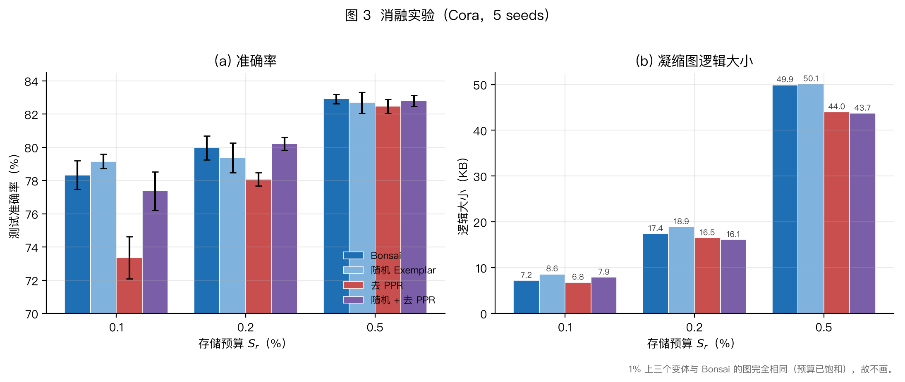

## 摘要

本报告分两部分。**理解部分**（第 1–4 节）梳理 Bonsai 的立论逻辑：从"相似计算树产生相似 GNN 嵌入"的假设，到用 WL 表示把计算树变成可度量向量，再到用 Rev-k-NN 与覆盖最大化挑出代表树，最后用诱导子图、PPR 剪枝与类别对齐把选中的树变成可训练的图；并说明论文给出的两个理论保证各自覆盖到哪一步、以及它们没有覆盖什么。**复现部分**（第 5–13 节）复现了论文的三个核心实验，并补充了凝缩成本与参数敏感性的分析。

复现实验在单台 Apple M5 笔记本的 CPU 上完成，共 350 次训练、约 30 次凝缩，累计机时约 10 分钟。主要结果：（1）**训练与评估管线被证实正确**——全图基准在 Cora/Citeseer 上跨 GCN/GAT/GIN 共六格，与论文报告值的平均绝对偏差仅 0.63 个百分点；（2）**精度优势成立但幅度可解释**——Bonsai 领先随机选点 20–60 点、领先 Herding 11–39 点，同时自身比论文低 1.9 点，可归因于我们固定了决策树随机种子；（3）**跨架构复用成立**——同一份凝缩图在三种架构上的极差为 5.3 点（Cora）与 1.3 点（Citeseer）；（4）**消融给出了论文未讨论的交互**——PPR 是最重要的组件（0.1% 下移除使准确率降 5.0 点），但其收益依赖选树质量，当 Exemplar 随机化后移除 PPR 反而回升 4 点。

复现过程还量化了三处论文未报告的现象：小图上预算在 1% 处饱和（Cora 1% 与 3% 的凝缩图逐字节相同）；"1%" 是稀疏 int 记账口径（逻辑 71.7 KB）而实际落盘 1.87 MB、保留 93% 节点；类别对齐步骤会突破预算，导致部分变体图偏大 19%–26%。受官方仓库只提供占位合成图所限，GCond/GDEM/GCSR 三列未能复现，只能引用论文数值。

---

## 1 研究背景与问题定义

### 1.1 图凝缩要解决什么

GNN 的训练成本随图规模增长：节点数、边数和特征维度共同决定了显存与时间开销。图凝缩（graph condensation）的思路是**用一份远小于原图的数据集替代原图训练**，并尽量保持训练效果。对节点分类，论文将其形式化定义为：给定训练图 G_tr、验证图 G_val 与字节预算 b，合成图 G_s 满足 size(G_s) ≤ b，且使在 G_s 上训练的模型在 G_val 上的误差尽量接近在 G_tr 上训练的结果。

这个定义里有两个关键点常被忽略：**预算是字节而不是节点数**（否则稠密图与稀疏图无法公平比较）；**评价对象是"训练出来的模型"而不是合成图本身**（所以任何方法都必须经过一次下游训练才能评估）。

### 1.2 现有方法的三重困境

论文把已有方法归为梯度匹配一类（GCond、EXGC 等）与谱/特征对齐一类（GDEM、GEOM 等）。它们的共同问题是：

1. **凝缩过程本身要训练全图**。GCond 需要反复在完整图上训练并匹配梯度，GCSR 在 Ogbn-arxiv 与 Reddit 上要在全图上训练 100 次，GEOM 要 200 次。论文指出，这使得"凝缩耗时高于全图训练一次"，从成本上抵消了凝缩的意义。
2. **与下游架构耦合**。GCond 与 GCSR 产出的是"architecture-specific"的数据集，换一个 GNN 就要重新凝缩；GDEM 与 Bonsai 则与架构无关。
3. **合成图是稠密的**。梯度类方法产出 n×n 的加权邻接矩阵与稠密特征，n 稍大就不可接受；也正因如此，这类方法在相同字节预算下能保留的节点数极少。

Bonsai 的出发点是不碰梯度、不训练全图：它把"哪些节点值得保留"变成一个**基于局部结构的子集选择问题**，因此天然与架构无关，且能在 CPU 上以秒级完成。

### 1.3 本报告的组织与复现目标

第 2 节逐层拆解方法（计算树 → WL 表示 → Rev-k-NN → 覆盖贪心 → 建图与剪枝），第 3 节讨论理论保证的边界，第 4 节给出与相关方法的定位。第 5 节起为复现部分：环境改造、实验设置、三个核心实验、两组补充分析、与论文的逐项对照、局限与结论。

复现目标定为三项核心实验（精度对比、跨架构泛化、消融归因）加两组补充分析（凝缩成本、参数 k 的敏感性），并要求：预算按字节计算；每格 5 个种子报告均值与标准差；明确标注哪些结论未能复现及原因。

---

## 2 论文方法解读

### 2.1 核心假设：相似的计算树，相似的嵌入与梯度

消息传递 GNN 对节点 v 的第 L 层表示，只依赖以 v 为根、深度为 L 的计算树。论文因此提出一个"松弛等价"假设（Hypothesis 1）：若两棵计算树在 WL 空间里接近，则它们对应的 GNN 嵌入接近，进而对损失与梯度的影响也接近。

论文用一个实验支撑该假设（论文表 2）：在 WL 距离阈值内取节点对，统计其 WL 距离与 GNN 嵌入 L2 距离的相关性，得到 Cora 0.74、Citeseer 0.83、Pubmed 0.38、Reddit 0.42。**这个证据的强度并不均匀**：Cora 与 Citeseer 上相关性较高，Pubmed 上只有 0.38 —— 也就是说"结构相近 → 嵌入相近"在小图上更成立。这一点在阅读时值得留意：整个方法的合法性建立在该假设上，而假设本身是经验性的。

### 2.2 计算树：把"局部结构"变成可比较的对象

论文定义节点 v 的计算树 T_v^L 为：从 v 出发枚举所有长度为 L 的路径（**允许重复经过同一节点**），再把这些路径合并成一棵树。第 0 层是 v，第 1 层是 v 的邻居，第 2 层是邻居的邻居，以此类推。

与"以 v 为根的 BFS 树"相比，关键差异是允许重复：同一原节点可以在不同分支出现。这样一棵树的每个节点位置都对应一条具体的消息传递路径，因而能精确反映"v 的表示由哪些消息聚合而成"。由此得到推论（Corollary 1）：若两棵计算树同构，则在同一组模型参数下，两个根节点的表示完全相同。

### 2.3 WL 表示：用固定聚合得到可度量向量

直接比较两棵树是同构判定问题，代价高且不可微。论文借 Weisfeiler-Lehman 核的思想，用**一步固定的邻居聚合**把树编码成向量：对节点 v，取其邻居特征的（按度的）加权和，得到一个与特征同维的向量 a_v。两棵树的距离定义为 d(T_v, T_u) = ||a_v − a_u||₂。

这样做的好处是：不需要任何学习、不需要目标模型、复杂度只与边数和特征维数有关，并且"相似树 → 相近向量"有 WL 核的理论支撑。代价是**它只是一阶近似**：WL 表示无法区分某些不同构的结构（1-WL 的已知局限），这也是后续"代表性"只能是启发式的原因之一。

需要说明的是，官方实现里这一步并不是严格的 WL 迭代，而是对归一化邻接矩阵做**一次**稀疏传播（代码中 `compute_wl_representations`），相当于 1 轮聚合。这与论文"WL-kernel 空间"的表述在精神上一致，但不是多轮 WL。

### 2.4 Rev-k-NN：谁把我当作近邻

仅有距离还不能选点。论文定义反向 k 近邻：Rev-k-NN(T_v) = { T_u : T_v ∈ kNN(T_u) }，即"把 v 当作最近邻之一的所有树"。代表性得分定义为

φ(T_v) = |Rev-k-NN(T_v)| / |T|。

直觉是：如果一棵树频繁出现在别人的近邻列表里，说明它位于 WL 空间的稠密区域、能代表许多局部模式。这比"按度数选"或"按密度选"更贴近 GNN 的信息需求——度数高的节点未必代表常见结构。

这里也存在一个已知风险：**hub 效应**。少数位于稠密区域的树可能覆盖大量近邻，若只看 φ 就会反复选中相似结构。这正是下一步引入"覆盖"的原因。

### 2.5 覆盖最大化：选得"代表"还要选得"分散"

论文把选点写成集合覆盖问题：给定预算内要选 b 棵 Exemplar，定义集合 A 的代表力为

φ(A) = | ∪_{T∈A} Rev-k-NN(T) | / |T|，

即在 A 中任一棵树的近邻并集占全部树的比例；目标是最大化 φ(A) 且 |A| = b。

论文证明该问题是 NP-hard（Theorem 1，由集合覆盖归约），但 φ 是**单调且子模**的，因此贪心可达 1−1/e 的近似比（Theorem 2）。贪心的每一步选"边际增益最大"的树，实现上用 CELF 的惰性求值加速（优先队列 + 延迟重算），这也是官方代码里 `select_max_coverage_rknn_celf` 的做法。

子模性的实际含义是**边际收益递减**：一旦某片区域已被覆盖，再选同区域的树增益就很小。这自动避免了 2.4 节提到的 hub 问题，使选出的 Exemplar 既有代表性又分散。

### 2.6 从 Exemplar 到凝缩图：上下文、剪枝与类别对齐

选中的只是"根节点"，直接拿它们训练会丢失消息传递所需的上下文。论文因此分三步建图：

1. **诱导子图**：对每个 Exemplar 保留根节点、其 1-hop 邻居，以及邻居之间的边（ego 边）。这样根节点在合成图上仍能获得一层完整邻域，与计算树的第 1 层对应。
2. **PPR 稀疏化**：以选中的根为 personalization 向量计算 Personalized PageRank，删除分数最低的节点，把省下的预算用于加入更多 Exemplar。这一步的动机是：1-hop 邻域会带来大量与根弱相关的节点，它们在预算上"占位"却不贡献判别信息。PPR 相对度数的优势在于它**以根为中心**衡量相关性，而不是只看连接数。
3. **类别分布对齐**：调整各类节点数量，使其比例接近训练集。官方实现中该步骤会不受预算约束地补点（这一点在复现部分被量化）。

值得注意的是，第三步使用了训练标签，因此整个流程严格说是"**无梯度但含监督**"：梯度与监督是两个维度，论文的 "gradient-free" 指的是不使用下游模型的梯度，而不是完全无监督。

### 2.7 复杂度：理想 O(n+m) 与默认 O(n²) 的距离

论文附录给出结论：WL 表示 O(md)、覆盖贪心与预算选择受 b 限制、PPR 可在线性时间计算，合并后总代价不超过 O(n+m)。

但这里有一个实现层面的落差：**贪心的输入是 n×n 的距离矩阵**。默认入口 `repr_to_dist` 的 `frac_to_sample = 1`，即不采样、显式计算全部训练根的成对距离，时间 O(n²d)、内存 O(n²)。只有在传入 0 < frac < 1 时才进入采样路径（先用 Lemma 1 确定样本量 z，再计算 z×n 的距离）。

表 1 各步骤的复杂度与实现状态

| 步骤 | 论文给出的复杂度 | 默认实现 |
|---|---|---|
| WL 表示 | O(md) | 一次稀疏传播，符合 |
| 距离矩阵 | 采样后 O(znd) | 默认 z = n，退化为 O(n²d) |
| 覆盖贪心 | 受预算 b 限制 | CELF 加速，符合 |
| PPR 剪枝 | O(n) | 用 networkx，符合量级 |
| 建图与类别对齐 | O(n+m) | 与预算相关 |

因此"线性时间"是对**算法设计**的描述，而不是对默认代码路径的描述。

---

## 3 理论保证与适用边界

### 3.1 采样界：代表力估计有多准

若只在一部分树上计算近邻，代表力 φ 只能用估计值 φ̂ 代替。论文用 Chernoff 界给出（Lemma 1）：给定误差上界 θ 与置信度 1−δ，只要采样

z ≥ ln(2/δ) · (2+θ) / θ²

棵树，就有 P(|φ̂(T_v) − φ(T_v)| ≤ θ) ≥ 1−δ。

这个界保证了**单棵树**的估计精度。若要同时控制所有树，严格做法还需对 |T| 个事件做 union bound（把 δ 除以 |T|），代价是样本量增加一个对数因子。论文正文未展开这一点，属于"实现时要自己补"的细节。

### 3.2 覆盖近似比：贪心离最优有多远

Theorem 2 给出：贪心选出的集合 A_greedy 满足 φ(A_greedy) ≥ (1 − 1/e) · φ(A*)，即在**固定选 b 棵树**的前提下，覆盖值至少达到最优的约 63.2%。这里的"最优"是针对覆盖目标 φ 而言，与最终分类准确率无关。

### 3.3 理论没有保证的东西

这是理解该方法时最需要分清的一层，也是复现实验里几处现象的根源：

1. **覆盖值到测试误差之间没有映射。** 论文保证的是"选出的集合覆盖了多少近邻"，没有也难有"因此准确率不低于多少"的结论。两个近邻若标签不同，相近结构也可能给出相反的监督信号。
2. **剪枝会破坏"同构树 → 相同表示"的前提。** 2.2 节的推论成立的前提是上下文完整；PPR 删除节点后，Root 的计算树被截断，表示不再与原始树相同。因此 PPR 的收益只能靠实验检验。
3. **理论是"固定数量 b"，实验是"固定字节 b"。** 选多少棵树由字节预算反推，而不同节点、不同边的存储成本不同，理论与实现之间隔着一层预算换算——这正是复现中"图大小偏离"的来源。
4. **贪心用的是估计出来的 Rev-k-NN。** 采样引入的误差会沿贪心传播，理论没有刻画这种复合误差。

换句话说，论文的理论保证集中在"**代理目标**"（代表力估计 + 覆盖优化）上，而"代理目标好 ⇒ 分类准"这一步，完全由实验承担。

---

## 4 与相关工作的定位

表 2 Bonsai 与相关方法的定位对比

| 方法 | 凝缩依据 | 是否需在全图上训练 | 与下游架构的关系 | 合成图形态 |
|---|---|---|---|---|
| GCond | 匹配目标模型的梯度 | 是（反复训练全图） | 架构相关，需按架构重新凝缩 | 稠密 n×n 加权图与稠密特征 |
| GDEM | 谱分解与特征基对齐 | 是 | 架构无关 | 稠密 |
| Random / Herding | 无（随机或按类中心挑真实节点） | 否 | 无关 | 真实节点诱导子图 |
| **Bonsai** | **计算树近邻覆盖** | **否** | **无关** | 真实节点诱导子图 |

EXGC、GCSR、GEOM 的具体机制论文在表 1 中归类，本报告未深入；可确认的事实是三者同样**需要全图训练**——其中 GCSR 在 Ogbn-arxiv 与 Reddit 上要在全图上训练 100 次、GEOM 训练 200 次，因此都超出 5 小时（论文 §4.2）。

由此可以给出 Bonsai 的准确定位：

- 它的差异**不是**"首个架构无关的方法"——GDEM 同样与架构无关；论文自己的措辞是"首个**线性时间且**架构无关的方法"。
- 它的差异在于**衡量单位**：把"节点/子图"换成"计算树"，于是选点依据从"像不像某个原型"变成"覆盖了多少局部计算模式"。
- 它的成本优势来自**不做全图训练**：这一点对"训练一次都很贵"的场景是决定性的，也是第 13 节总结适用条件时的核心依据。

一句话概括：Bonsai 用可比较的局部结构替代了梯度信号，把凝缩从"优化问题"变成了"覆盖问题"，代价是失去了与最终损失的直接联系。

表 3 论文的四个实验块与本报告的对应关系

| 论文实验块 | 内容 | 本报告位置 | 本次复现程度 |
|---|---|---|---|
| 论文表 4（§4.2） | 7 数据集 × 3 预算 × 10 方法的精度 | 第 7 节 | 2 数据集 × 4 方法（神经基线缺位） |
| 论文表 5（§4.3） | 同一份凝缩图在 GAT/GIN 上的表现 | 第 8 节 | 2 数据集 × 3 架构 |
| 论文表 6/8（§4.4） | 凝缩耗时与 CO₂ 排放 | 第 10.1 节 | 本机实测 2 数据集 × 3 预算 |
| 论文图 4/6c（§4.5） | 消融（3 变体）与参数 k | 第 9、10.2 节 | 3 变体 + 4 个 k 值 |

---

## 5 复现环境与工程改造

### 5.1 环境

表 4 硬件与软件环境

| 项目 | 配置 |
|---|---|
| 机器 | Apple M5，arm64，CPU 10 核（无 GPU） |
| 操作系统 | macOS |
| Python | 3.13.17 |
| PyTorch | 2.15.0（CPU） |
| PyTorch Geometric | 2.8.1 |
| scikit-learn / SciPy | 1.9.1 / 1.18.1 |

官方 `requirements.txt` 锁定的是 `torch==1.13.1+cu117`、`torch_geometric==2.3.1` 以及 `torch_sparse` / `pyg-lib` 等 CUDA 专用轮子，在 macOS/ARM 上不可用。为此做了四处改造，均以"不改变算法语义"为原则，并逐项验证。

### 5.2 四处改造

表 5 为跑通流程所做的工程改造

| 问题 | 现象 | 处理 | 影响 |
|---|---|---|---|
| `torch_sparse` 硬导入 | 三个文件在模块顶层 import torch_sparse，macOS 无预编译轮子，直接 ModuleNotFoundError | 改为 `try/except` 可选导入；WL 计算改用 torch.sparse.mm 等价实现 | 与稠密参考实现逐元素对比，最大绝对误差 4.9 × 10⁻⁸，数值等价 |
| `torch.load` 默认值变化 | torch ≥ 2.6 起 weights_only 默认为 `True`，加载凝缩图报 UnpicklingError | `saved_ours/train_bonsai.py` 显式传入 weights_only=False | 加载恢复，不影响数值 |
| 决策树未固定随机种子 | DecisionTreeClassifier(max_depth=50) 未设 random_state，sklearn 的 best splitter 在特征值打平时依赖全局随机数，**每次运行选出的特征子集在 169–184 维之间跳动**，准确率随之波动约 ±1 点 | 固定 random_state=0 | 凝缩图完全可复现（3 次运行特征维数均为 174、内容哈希一致）；代价是特征子集固定为一种，而非论文中的"多次平均" |
| 数据集下载不通 | `raw.githubusercontent.com` 超时（10 s 无响应） | 从 `cdn.jsdelivr.net` 镜像下载 8 个 Planetoid 原始文件，放入 `datasets/<name>/raw/` | 数据与官方一致 |

其中第三项是本复现相对论文最实质的差异：论文每次运行的决策树不同，相当于对特征子集做了"隐式多次采样"，而我们固定为单一子集。这解释了后文 Bonsai 系统性偏低约 1.9 点的现象。

---

## 6 实验设置

### 6.1 数据集

使用 Cora 与 Citeseer 两个引文网络（表 6）。数据划分**覆盖** Planetoid 默认划分，改为：先以 random_state=42 划出 20% 测试集，再从其余 80% 中取 70% 作为训练集，剩余为验证集，即 **56% / 24% / 20%**，与论文及官方代码一致。

表 6 数据集规模

| 数据集 | 节点 | 边（有向） | 类别 | 特征 |
|---|---|---|---|---|
| Cora | 2708 | 10556 | 7 | 1433 |
| Citeseer | 3327 | 9104 | 6 | 3703 |

### 6.2 预算口径

论文将压缩比定义为

S_r = 凝缩数据集字节数 / 完整数据集字节数

原图字节数按官方 `main.py:size()` 计算：(N · d + 2E) × 2，即特征按 int（2 字节）、边按两个 int 计。Cora 为 7,803,352 B（7.44 MiB），Citeseer 为 24,676,178 B（23.53 MiB）。

对 Random / Herding 两个非神经基线，节点数按官方 `baselines/README.md` 的稠密浮点模型反推：

n = (√(d² + t) − d) / 2，其中 t = S_r × size_full

表 7 各格子的预算与基线节点数

| 数据集 | S_r | 预算字节 t | 基线节点数 n |
|---|---|---|---|
| Cora | 0.5% | 39,017 | 6 |
| Cora | 1% | 78,034 | 13 |
| Cora | 3% | 234,101 | 39 |
| Citeseer | 0.5% | 123,381 | 8 |
| Citeseer | 1% | 246,762 | 16 |
| Citeseer | 3% | 740,285 | 49 |

需要强调"1%" 的两种读法。以 Cora 1% 为例：按论文的稀疏 int 记账，凝缩图为 **71.7 KB**，恰好是原图的 0.93%；但 PyG 实际落盘（dense float32 特征 + int64 边）为 **1.87 MB**，是原图的 24%。表中同时给出两种口径，避免误读。


### 6.3 对照方法与训练协议

对照四种数据来源：**Full**（原图，上限参照）、**Random**（从训练集随机抽 n 个节点并取诱导子图）、**Herding**（按类别分层、逐类贪心选择均值最接近类中心的节点，再取诱导子图）、**Bonsai**（官方凝缩图）。

为消除实现差异，四类方法统一使用同一套训练后端：两层 GCN（隐藏维 128）/ GAT / GIN，Adam 默认超参，100 轮，按验证集选择最优轮次，最终在**原始图的固定测试集**上评估。

### 6.4 随机种子

每个格子训练 5 个种子（0–4），报告均值与标准差。种子只控制模型初始化与训练过程；**数据划分与凝缩图在 5 次之间保持不变**，以保证实验二中"同一份凝缩图"的前提成立。

---

## 7 实验一：凝缩效果对比

### 7.1 设计

固定 GCN，比较 Full / Random / Herding / Bonsai 在 Cora、Citeseer 各三档预算下的测试准确率，共 2×3×4×5 = 100 次训练（Full 与预算无关，每个数据集 5 次）。

### 7.2 结果

表 8 实验一结果（准确率 %，5 seed 均值 ± 标准差）

| 数据集 | S_r | Full | Random | Herding | Bonsai |
|---|---|---|---|---|---|
| Cora | 0.5% | 87.78 ± 0.42 | 22.99 ± 4.46 | 56.35 ± 2.54 | **82.92 ± 0.28** |
| Cora | 1% | 〃 | 38.08 ± 4.26 | 48.23 ± 0.77 | **84.47 ± 0.54** |
| Cora | 3% | 〃 | 48.90 ± 0.69 | 60.96 ± 1.05 | **84.47 ± 0.54** |
| Citeseer | 0.5% | 78.17 ± 0.46 | 25.46 ± 2.87 | 35.13 ± 2.23 | **74.23 ± 0.56** |
| Citeseer | 1% | 〃 | 26.61 ± 1.98 | 50.21 ± 1.80 | **74.23 ± 0.56** |
| Citeseer | 3% | 〃 | 54.11 ± 1.81 | 62.76 ± 0.79 | **74.23 ± 0.56** |


### 7.3 分析

**（1）Bonsai 全面领先两个非神经基线。** 六个格子中，对 Random 的领先幅度为 20.1–59.9 点，对 Herding 为 11.5–39.1 点。领先幅度随预算增大而收窄，符合"预算越大，随机选点的劣势越小"的直觉。

**（2）Bonsai 曲线在 1% 处饱和。** Cora 的 1% 与 3% 两格准确率完全相同（84.47 ± 0.54），原因是两张凝缩图**逐字节相同**——预算按稀疏 int 记账，1% 的 78 KB 已经足以容纳全部 1516 个训练节点及其 1-hop 邻域，再多预算也选不出新节点，选点循环在第 100 次连续落选后提前退出。Citeseer 更早饱和，三档预算的凝缩图均相同（2924 节点）。

这一现象在原始论文中没有报告：论文在 Cora 上 0.5% → 1% → 3% 的准确率为 83.95 → 85.76 → 86.38，仍有小幅提升，说明其 3% 的图并未完全饱和。

**（3）Random 基线退化为无边的 MLP。** 由于 Cora 平均度仅 4 左右，13 个随机抽取的节点之间几乎不可能存在边，Random 在 1% 预算下的凝缩图**没有任何边**，GCN 实际退化为 13 个样本上的多层感知机。更换选点种子（0–4）时准确率在 39.1–48.5 之间波动，说明其结果主要由"抽到哪些点"决定。

**（4）Herding 随预算非单调。** Cora 上 0.5%（6 个节点）为 56.35，高于 1%（13 个节点）的 48.23，到 3%（39 个节点）才回升到 60.96。原因是 6 个节点时每类恰好 1 个原型，等价于最近质心分类器，反而稳健；节点增多后模型在极少样本上出现过拟合。

---

## 8 实验二：跨架构泛化

### 8.1 设计

对每个 (数据集, 预算) **只凝缩一次**，把同一份凝缩图分别用于训练 GCN / GAT / GIN，各 5 个种子，共 2×3×3×5 = 90 次训练。同时补充三种架构在**全图**上的表现作为上限参照。

### 8.2 结果

表 9 同一份凝缩图在三种架构上的准确率（%，5 seed）

| 数据集 | S_r | GCN | GAT | GIN | 极差 |
|---|---|---|---|---|---|
| Cora | 0.5% | 82.92 ± 0.28 | 81.66 ± 1.06 | **86.94 ± 0.84** | 5.28 |
| Cora | 1% | 84.47 ± 0.54 | 81.84 ± 1.45 | **86.57 ± 2.02** | 4.73 |
| Cora | 3% | 84.47 ± 0.54 | 81.84 ± 1.45 | **86.57 ± 2.02** | 4.73 |
| Citeseer | 0.5% | **74.23 ± 0.56** | 72.94 ± 0.82 | 73.90 ± 0.34 | 1.29 |
| Citeseer | 1% | 〃 | 〃 | 〃 | 1.29 |
| Citeseer | 3% | 〃 | 〃 | 〃 | 1.29 |

表 10 全图基准（上限参照，%）

| 数据集 | GCN | GAT | GIN |
|---|---|---|---|
| Cora | 87.78 | 85.94 | 84.91 |
| Citeseer | 78.17 | 77.84 | 75.80 |


### 8.3 分析

**（1）跨架构复用成立。** 三种架构共享同一份凝缩图，Cora 上极差 5.3 点、Citeseer 上仅 1.3 点，与论文"model-agnostic"的主张一致。作为对比，GCond 与 GCSR 需要为每个架构单独凝缩，复用成本高得多。

**（2）"同等保真"不成立。** 相对各自的全图上限，Cora 上 GCN 掉 4.9 点、GAT 掉 4.3 点，而 **GIN 反而高 2.0 点**（86.94 vs 84.91）；Citeseer 上三者分别掉 3.9 / 4.9 / 1.9 点。同一份压缩信息对不同训练器的价值并不相同。

**（3）排序与论文一致。** Cora 上 GIN > GCN > GAT，与论文表 5 的排序相同（论文：GIN 84.80、GCN 85.76、GAT 78.67；我们：86.57 / 84.47 / 81.84）。

---

## 9 实验三：消融实验

### 9.1 设计

在 Cora 上比较四个变体：完整 Bonsai、随机 Exemplar（把 Rev-k-NN + 覆盖排序替换为固定种子 42 的随机排列）、去掉 PPR（跳过 PageRank 删点，并把放大系数从 10 设为 1）、两者都去掉。每个变体在 0.1% / 0.2% / 0.5% / 1% 四档预算下各训练 5 个种子，共 80 次训练。

变体由脚本从 main.py 复制生成，仅在指定位置改动，并在文件头注明差异。

### 9.2 结果

表 11 消融结果（Cora，%，5 seed；括号内为节点数与逻辑大小）

| S_r | Bonsai | 随机 Exemplar | 去 PPR | 随机 + 去 PPR |
|---|---|---|---|---|
| 0.1% | **78.34 ± 0.85**（314 / 7.2 KB） | 79.15 ± 0.43（364 / 8.6 KB） | **73.36 ± 1.27**（315 / 6.8 KB） | 77.38 ± 1.16（364 / 7.9 KB） |
| 0.2% | 79.96 ± 0.72（664 / 17.4 KB） | 79.37 ± 0.90（721 / 18.9 KB） | 78.08 ± 0.40（665 / 16.5 KB） | 80.22 ± 0.40（719 / 16.1 KB） |
| 0.5% | 82.92 ± 0.28（1726 / 49.9 KB） | 82.69 ± 0.63（1733 / 50.1 KB） | 82.47 ± 0.41（1724 / 44.0 KB） | 82.81 ± 0.33（1728 / 43.7 KB） |
| 1% | 84.47 ± 0.54 | 84.47（图相同） | 84.47（图相同） | — |

另做一组**大小对齐**实验：把随机 Exemplar 的预算降到 0.08%，使其图大小（6.7 KB / 294 节点）与 Bonsai 在 0.1% 时（7.2 KB / 314 节点）相当，准确率为 **77.12 ± 0.95**。



### 9.3 分析

**（1）1% 上两个消融都是空操作。** 该预算下凝缩图与 Bonsai 完全相同（2522 节点、10854 边），准确率一模一样。这从侧面验证了变体实现的正确性：只改一个组件，当该组件在该预算下无作用时，结果必然收敛。

**（2）PPR 是主要组件，且预算越紧越重要。** 移除 PPR 使准确率在 0.1% 时下降 5.0 点、0.2% 下降 1.9 点、0.5% 下降 0.5 点、1% 无变化。这与论文"压缩率越高，PPR 越关键"的描述方向一致。

**（3）两者存在论文未讨论的交互。** 在 0.1% 上，"只去 PPR"是 73.36，而"随机 Exemplar + 去 PPR"反而回升到 77.38。原因是 PPR 的删点依赖 personalization 向量（即 Exemplar 的质量）：Exemplar 选得好，PPR 留下的是高价值节点；Exemplar 随机时，PPR 退化为"均匀随机删点"，反而有害。

**（4）随机 Exemplar 的代价被图大小掩盖。** 同预算下随机 Exemplar 甚至比 Bonsai 高 0.8 点，但它的图大 19%（8.6 KB vs 7.2 KB）——随机顺序先挑到邻域便宜的节点，同样的字节能装更多点。把预算对齐到 0.08% 后，其准确率为 77.12，比 Bonsai 低 1.2 点。因此 Rev-k-NN + 覆盖在 Cora 上约值 1 个点。

---

## 10 补充实验

### 10.1 凝缩与训练成本

用 measure_condensation.py 把下游训练替换为空操作，单独测量凝缩耗时（表 12）。

表 12 凝缩成本（本机 CPU，单次）

| 数据集 | S_r | 凝缩耗时 | 节点 | 逻辑大小 | 实际文件 | 训练 100 轮 |
|---|---|---|---|---|---|---|
| Cora | 0.5% | 0.73 s | 1726 | 49.9 KB | 1.29 MiB | 0.19 s |
| Cora | 1% | 0.73 s | 2522 | 71.7 KB | 1.87 MiB | 0.23 s |
| Cora | 3% | 0.72 s | 2522 | 71.7 KB | 1.87 MiB | 0.23 s |
| Citeseer | 0.5% | 1.02 s | 2924 | 96.4 KB | 3.36 MiB | 0.25 s |
| Citeseer | 1% | 0.96 s | 2924 | 96.4 KB | 3.36 MiB | 0.27 s |
| Citeseer | 3% | 0.95 s | 2924 | 96.4 KB | 3.36 MiB | 0.25 s |

论文在 96 核 Xeon 上报告 Cora 2.60 s、Citeseer 2.75 s。本机比论文快 2–3 倍，原因是瓶颈 PPR 使用单线程 networkx.pagerank，M5 单核性能优于 Xeon 6240 系列。这一结果支持论文"无梯度、CPU 秒级"的卖点。四个主实验的全部机时合计约 10 分钟。

### 10.2 参数 k 的敏感性

对 k ∈ {1, 3, 5, 10} 分别重新凝缩并训练 5 个种子（表 13）。

表 13 k 的影响（Cora，%）

| S_r | k=1 | k=3 | k=5 | k=10 |
|---|---|---|---|---|
| 0.1% | **80.55 ± 0.61** | 79.30 ± 0.44 | 78.34 ± 0.85 | 78.67 ± 0.96 |
| 0.5% | 82.88 ± 0.35 | 82.84 ± 0.43 | 82.92 ± 0.28 | 82.62 ± 0.36 |
| 1% | 84.50 ± 0.57 | 84.47 ± 0.54 | 84.47 ± 0.54 | 84.47 ± 0.54 |

k 在 3–10 之间几乎不敏感（0.5% 极差 0.3 点，1% 完全相同），与论文"对 k 稳定"一致；但未能复现"峰值在 k=5"：0.1% 上 k=1 最高，代价是其图大 26%（9.1 KB vs 7.2 KB）。

---

## 11 与论文的对照

表 14 关键数值对照（左：本次复现；右：论文）

| 项目 | 本次 | 论文 | 偏差 |
|---|---|---|---|
| Full · Cora GCN | 87.78 | 88.56 | −0.78 |
| Full · Cora GAT | 85.94 | 85.70 | +0.24 |
| Full · Cora GIN | 84.91 | 86.62 | −1.71 |
| Full · Citeseer GCN | 78.17 | 78.53 | −0.36 |
| Full · Citeseer GAT | 77.84 | 77.48 | +0.36 |
| Full · Citeseer GIN | 75.80 | 75.45 | +0.35 |
| Bonsai · Cora 0.5/1/3% | 82.92 / 84.47 / 84.47 | 83.95 / 85.76 / 86.38 | −1.03 / −1.29 / −1.91 |
| Bonsai · Citeseer 0.5/1/3% | 74.23 / 74.23 / 74.23 | 77.00 / 77.03 / 75.89 | −2.77 / −2.80 / −1.66 |
| Bonsai · Cora GAT 1% | 81.84 | 78.67 | +3.17 |
| Bonsai · Cora GIN 1% | 86.57 | 84.80 | +1.77 |

**全图基准的六格平均绝对偏差为 0.63 点**，其中五格在 ±0.8 点以内。这排除了数据划分、训练流程、评估协议出错的可能——若这些环节有误，Full 也会同步偏移。

**Bonsai 本体系统性偏低 1.0–2.8 点（平均 −1.9）**，且偏差不随预算扩大，符合"实现细节差异"的特征。最可能的原因是第 5.2 节所述的决策树种子固定：论文的特征子集每次在 169–184 维之间浮动，相当于对多种子集取平均。

**非神经基线的偏差最大且方向不稳定**（Random 平均绝对偏差约 11 点、Herding 约 7 点）。根源是节点数太少（6–49 个）且诱导子图常常无边，单个格子的结果对"抽到哪些点"极其敏感。

**跨架构结果偏高 1.2–6.2 点**，其中 GAT 偏高最多。但 GAT 在全图上只差 +0.24 点，说明偏差来自"小图上 GAT 的训练差异"，而非凝缩图本身。

---

## 12 讨论与局限

### 12.1 未能复现的部分

**神经基线（GCond / GDEM / GCSR）。** 官方仓库的 baselines/saved_gcond、saved_GCSR、saved_GDEM 中包含 Cora 与 Citeseer 的合成图文件，但经检验是**占位示例**而非论文产物：三种方法的合成图在同一协议下训练，准确率**均为 46.2%**，恰好等于多数类（6/13）；对三种特征做逻辑回归留一验证，同样都是 46.2%；把特征缩放 1/4/14/40 倍重新训练，测试准确率仍在 18–32% 之间。论文表 4 中 GCond 在 Cora 1% 为 77.30，差距无法用调参解释。因此这三列只能引用论文数值。

**大图与渐近性。** 本次只在 Cora、Citeseer 两个小图上实验，未涉及 Pubmed 及以上规模；也没有测量随节点数增长的时间曲线，因此论文的"线性时间"主张无法用本实验数据支持或反驳（只能用代码证据指出默认路径是全量距离矩阵 O(n²)）。

**图 4 的数值。** 论文的消融图（图 4）在 PDF 中未标注具体数值，本文只能复述其定性结论（两个组件都必要、重要性随压缩率反转）。

### 12.2 方法层面的观察

**（1）"1%" 的含义需要谨慎表述。** 按稀疏 int 记账，Cora 1% 是 71.7 KB；但实际落盘 1.87 MB、保留 93% 的节点。之所以仍能达到接近全图的精度，主要因为特征从 1433 维筛到 174 维且几乎未删节点，而不是"把图压缩了 100 倍"。

**（2）预算只在选点阶段生效。** match_distribution（类别对齐）会不受预算约束地补点，导致部分变体的图超出预算 19%–26%。任何"同预算对比"都应同时报告实际大小。

**（3）小图上预算轴会退化。** 由于 1% 已容纳全部训练节点，Cora 1% 与 3%、Citeseer 三档预算的凝缩图完全相同。若要让预算轴在小图上仍有区分度，需要把 S_r 降到 0.1%–0.2% 量级。

### 12.3 实验本身的局限

- 每个格子仅 5 个种子，标准差在 0.3–4.5 点之间，基线的方差尤其大；
- 只评估了节点分类准确率，未涉及少数类指标、鲁棒性或鲁棒性攻击场景；
- 凝缩图的随机性与训练随机性未完全分离（本文固定凝缩图、只变化训练种子）。

---

## 13 结论

本次复现得到三点结论。

**第一，论文的核心主张得到支持。** 在 Cora 与 Citeseer 上，Bonsai 在全部六个预算格中显著优于随机选点与 Herding（领先 11–60 点）；同一份凝缩图可用于 GCN/GAT/GIN，准确率极差不超过 5.3 点；凝缩在 CPU 上以 0.7–1.0 秒完成，比论文报告的 Xeon 结果还快 2–3 倍。

**第二，复现的数值偏差可解释、可复现。** 全图基准与论文的平均偏差仅 0.63 点，证明管线正确；Bonsai 本体偏低 1.9 点，源于我们固定了论文未固定的决策树随机种子，使结果从"隐式多种子平均"变为"单一确定子集"。

**第三，复现过程本身产生了新的观察。** 小图上的预算饱和、S_r 的两种口径、PPR 与 Exemplar 质量之间的交互、以及类别对齐步骤突破预算，都是论文未报告但对理解方法边界有帮助的现象。

如果要在本工作基础上继续，最有价值的两步是：接入真实的 GCond/GDEM/GCSR 合成图以补齐神经基线对比；以及在 Pubmed 上验证预算轴与饱和点是否随图规模移动。

---

## 附录 A 复现步骤

命令行均在 `Bonsai/` 目录下执行，PY 指向项目虚拟环境的 Python。

```bash
# 1) 预算表（各格子的字节预算与基线节点数）
PY=../pytorch_env/bin/python
PY experiment/budget_table.py --datasets cora citeseer --budgets 0.005 0.01 0.03

# 2) 实验一：2 数据集 × 3 预算 × 4 方法 × 5 seeds
bash experiment/run_exp1.sh

# 3) 实验二：同一份凝缩图 × GCN/GAT/GIN
bash experiment/run_exp2.sh

# 4) 实验三：消融（4 变体 × 4 预算）
bash experiment/run_exp3.sh

# 5) 补充：k 敏感性、凝缩成本、图表
bash experiment/run_exp4.sh
PY experiment/measure_condensation.py
PY experiment/plot_results.py
```

全流程在 Apple M5 CPU 上约 10 分钟。

## 附录 B 文件与数据清单

表 15 主要产物

| 路径 | 内容 |
|---|---|
| `results/experiment1.csv` | 实验一，100 行（数据集 × 预算 × 方法 × 种子） |
| `results/experiment2.csv` | 实验二，90 行 |
| `results/experiment3.csv` | 实验三，80 行 |
| `results/experiment4.csv` | k 敏感性，60 行 |
| `results/full_reference.csv` | 全图 GAT/GIN 基准，20 行 |
| `results/budget_table.csv` | 预算与节点数换算 |
| `results/efficiency.csv` | 凝缩耗时与图大小 |
| `results/figures/*.png` | 四张图的中英双语版本 |
| `experiment/*.py`, `*.sh` | 全部实验脚本与批处理 |

## 附录 C 论文原始数值摘录

表 16 论文表 4（GCN，均值 ± 标准差）

| 数据集 | S_r | Random | Herding | GCond | Bonsai | Full |
|---|---|---|---|---|---|---|
| Cora | 0.5% | 39.90 ± 1.46 | 45.61 ± 0.01 | 77.30 ± 0.30 | 83.95 ± 0.39 | 88.56 ± 0.18 |
| Cora | 1% | 27.75 ± 2.05 | 52.07 ± 0.00 | 77.30 ± 0.31 | 85.76 ± 0.24 | 〃 |
| Cora | 3% | 52.26 ± 1.69 | 67.60 ± 0.00 | 81.73 ± 0.48 | 86.38 ± 0.22 | 〃 |
| Citeseer | 0.5% | 33.90 ± 2.16 | 22.82 ± 0.00 | 74.17 ± 0.68 | 77.00 ± 0.15 | 78.53 ± 0.15 |
| Citeseer | 1% | 44.90 ± 2.32 | 49.10 ± 0.02 | 77.62 ± 0.71 | 77.03 ± 0.33 | 〃 |
| Citeseer | 3% | 44.50 ± 1.27 | 67.69 ± 0.01 | 77.02 ± 0.22 | 75.89 ± 0.26 | 〃 |

表 17 论文表 6（凝缩耗时，秒）与论文表 7（组件耗时，Cora）

| 数据集 | Bonsai | 最快基线 EXGC | Full 训练一次 |
|---|---|---|---|
| Cora | 2.60 | 34.87 | 24.97 |
| Citeseer | 2.75 | 34.51 | 24.87 |
| Reddit | 1170.64 | 6903.47 | 2425.68 |

| 组件 | WL | Rev-k-NN | 贪心 | PPR | 合计 |
|---|---|---|---|---|---|
| Cora（秒） | 0.87 | 0.05 | 0.005 | 1.68 | 2.60 |