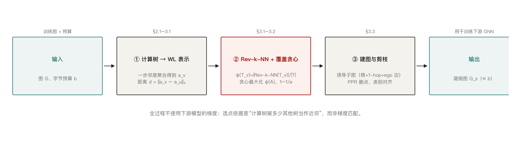
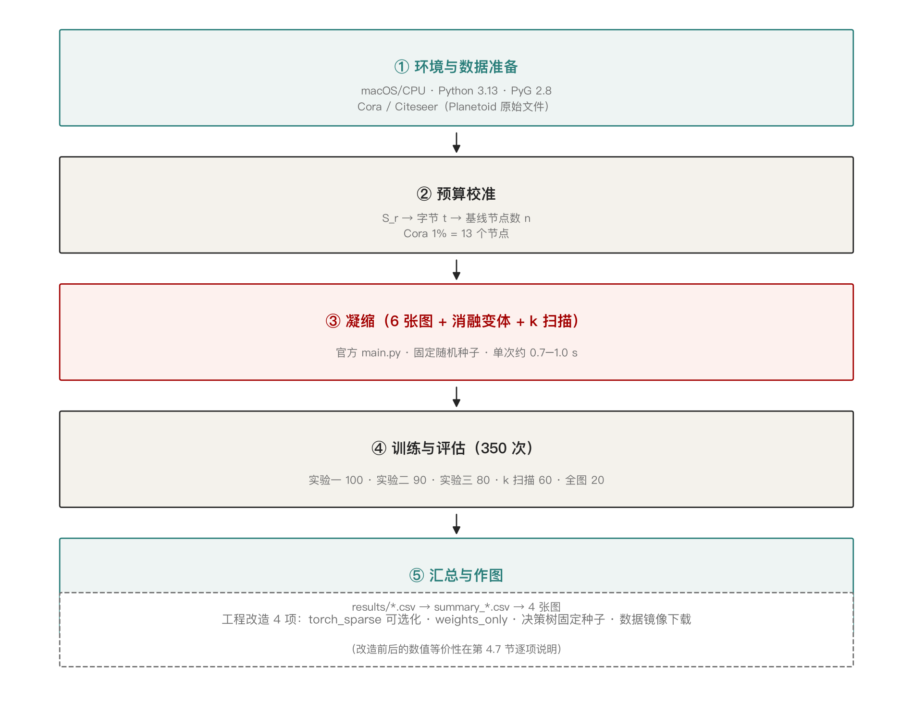
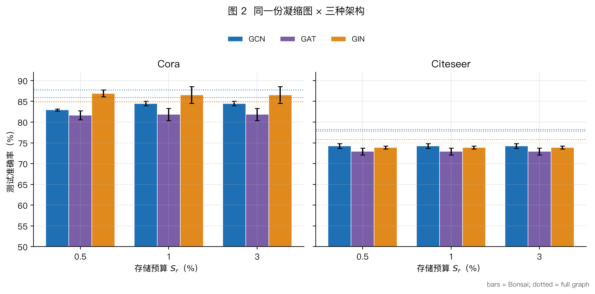
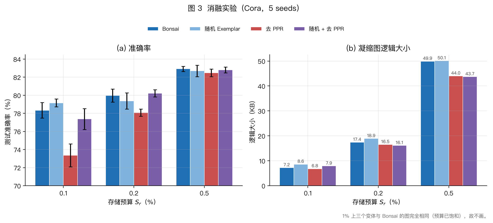
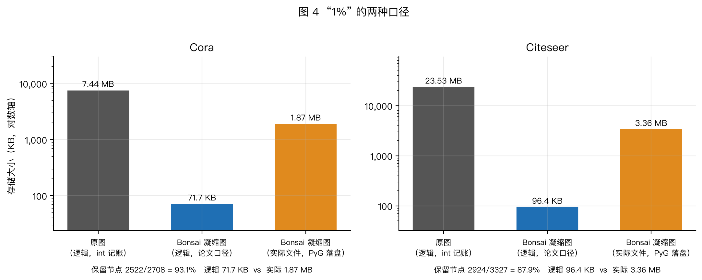

# Bonsai 图凝缩算法 论文复现报告

> 封面页（含课程、作者、论文与代码仓库信息）在 Word 文件中单独制作，本 Markdown 不含封面，从摘要开始。

---

## 摘要（Abstract）

图凝缩希望用一份远小于原图的数据集替代原图训练 GNN，从而降低存储与训练成本。现有方法多依赖梯度匹配或谱对齐，其共同问题是**凝缩过程本身要在全图上反复训练**，且部分方法产出的合成图与下游架构耦合。ICLR 2025 的 Bonsai 提出了一条不同路线：以消息传递的**计算树**为基本单位，用 WL 核把计算树编码为可度量向量，再用反向 k 近邻（Rev-k-NN）与最大覆盖贪心挑出代表树，最后通过诱导子图、PPR 剪枝与类别对齐构造凝缩图，全程不使用下游梯度。

本次复现完整跑通了官方代码，在 Cora 与 Citeseer 上复现了三个核心实验（精度对比、跨架构泛化、消融），并补充了凝缩成本与参数敏感性分析，共 350 次训练、约 30 次凝缩，机时约 10 分钟。主要结果：全图基准与论文的平均偏差仅 0.63 个百分点，说明训练与评估管线正确；Bonsai 在全部六个预算格上领先随机选点 20–60 点、领先 Herding 11–39 点，但自身比论文低 1.9 点，该偏差源于我们固定了论文未固定的决策树种子；同一份凝缩图在 GCN/GAT/GIN 上的极差为 5.3 点（Cora）与 1.3 点（Citeseer）；消融显示 PPR 是最重要的组件，但其收益依赖选树质量，这一交互论文未讨论。另外修复了四处会直接导致失败的工程问题（torch_sparse 硬依赖、torch.load 默认值、决策树种子、下载通道）。受官方仓库只提供占位合成图所限，GCond/GDEM/GCSR 三列未能复现。

**关键词：** 图凝缩；无梯度；计算树；Weisfeiler-Lehman 核；跨架构泛化；可复现性

---

# 第一章 研究背景与问题定义

## 1.1 研究背景

图神经网络（GNN）在节点分类、链路预测等任务上已成为主流方法，但其训练成本随图规模显著增长：节点数决定了特征与标签的存储，边数决定了每一层消息传递的计算量，而节点分类通常只能在一整张图上做直推式训练。当图达到百万甚至上亿节点时，单次训练的时间与显存开销都变得可观。

图凝缩（graph condensation，亦称 graph distillation）试图缓解这一矛盾：它不是压缩模型，而是**压缩训练数据**——合成一份规模远小于原图的数据集，使得在合成数据上训练出的模型，其表现尽量接近在原图上训练的结果。这样下游的反复训练、超参搜索、甚至多次实验都可以建立在更小的数据上。

按"依据什么信息选点/生成数据"，现有方法大致分两类。一类以**梯度匹配**为目标（GCond、EXGC 等）：把合成图设为可学习变量，反复在完整图上训练教师模型并匹配梯度。另一类以**谱或特征对齐**为目标（GDEM、GEOM 等）：对齐合成图与原图在特征基、特征值上的统计量。此外还有不依赖训练的简单基线，如随机选节点、按类中心选节点（Herding）。

## 1.2 研究问题

上述方法存在三方面不足，这也是原论文要解决的问题：

**（1）凝缩过程本身要在全图上训练。** 梯度类方法每一轮迭代都要在完整图上做前向与反向，GCSR 在 Ogbn-arxiv 与 Reddit 上需要在全图上训练 100 次、GEOM 需要 200 次。论文指出，这使得凝缩耗时甚至**高于全图训练一次**，从而抵消了凝缩的意义。

**（2）与下游架构耦合。** GCond 与 GCSR 产出的是"architecture-specific"的凝缩数据，换一个 GNN 就要重新凝缩；而实际场景中数据往往会被多个模型复用。

**（3）合成图稠密。** 梯度类方法产出 n×n 的加权邻接与稠密特征，n 稍大即不可接受；也正因如此，在相同的字节预算下这类方法能保留的节点极少。

原论文的目标是：**在不接触下游梯度的前提下，用可负担的计算量产出与架构无关的凝缩图，并在精度上不劣于现有方法。**

## 1.3 研究意义

从方法层面看，Bonsai 把图凝缩从"优化问题"改写成了"覆盖问题"：不再优化合成数据使其匹配梯度，而是在 WL 空间里选一组"能覆盖最多局部计算模式"的真实节点。这一视角转换带来两个直接好处——不需要在全图上训练，且天然与架构无关。

从工程层面看，该方法在 CPU 上以秒级完成凝缩（本次实测 Cora 0.73 秒），对算力受限的场景有实际价值。

从理论层面看，论文给出了采样界与覆盖贪心的近似比，但也留下了"代理目标到分类误差"的空白，这一点在第二章与第六章会展开讨论。

## 1.4 论文基本信息

表 1-1 论文基本信息

| 项目 | 内容 |
|---|---|
| 论文名称 | Bonsai: Gradient-free Graph Condensation for Node Classification |
| 作者 | Mridul Gupta, Samyak Jain, Vansh Ramani, Hariprasad Kodamana, Sayan Ranu（IIT Delhi） |
| 发表会议/期刊 | ICLR 2025 |
| 发表年份 | 2025 |
| 研究领域 | 图机器学习、图凝缩（数据集蒸馏） |
| 官方代码 | https://github.com/idea-iitd/Bonsai （本次核对提交 85ff7f7） |

---

# 第二章 原论文方法解析

## 2.1 核心思想

Bonsai 的出发点是消息传递 GNN 的结构性事实：节点 v 的第 L 层表示只依赖以 v 为根、深度为 L 的计算树。于是，若两个节点的计算树相似，它们在同一组参数下的嵌入就相似，对损失与梯度的影响也相似。

基于这一观察，方法把"选哪些节点"转化为"选哪些计算树"，整个流程的输入是**原图与字节预算 b**，输出是**规模不超过 b 的凝缩图**，中间依次经过四步：

1. 用固定的一步邻居聚合把每棵计算树编码为 WL 向量，并以 L2 距离度量相似性；
2. 统计每棵树出现在多少其他树的 k 近邻中（反向 k-NN），作为代表性得分；
3. 用最大覆盖贪心选出一组既代表性强、又彼此不重复的 Exemplar；
4. 对选中的 Exemplar 取诱导子图，再用 Personalized PageRank 删点、按类别分布补齐。

与已有方法的关键区别在于：**整个过程没有梯度**，凝缩不依赖任何下游模型，也因此不用在完整图上训练。

## 2.2 方法整体框架



图中五个方框对应论文 §3 的三小节：中间的"①计算树与 WL 表示"对应 §3.1，"②Rev-k-NN 与覆盖贪心"对应 §3.1–3.2，"③建图与剪枝"对应 §3.3。需要特别注意的是两个"非方法"的环节：输入侧只要求图与字节预算，不需要预先训练任何模型；输出侧产出的是由**真实节点**构成的稀疏子图，而不是稠密的合成特征矩阵。这两点正是它相对梯度类方法在成本与架构无关性上的来源。

## 2.3 核心模块解析

### 2.3.1 模块一：计算树与 WL 表示

- **解决的问题：** 如何把"局部结构"变成一个可比较、可计算的对象。
- **输入：** 原图 G=(V, E, X)，层数 L。
- **核心操作：** 对每个节点 v，枚举所有长度为 L 的路径（**允许重复经过同一节点**）并合并成一棵树；然后用一步固定的邻居聚合（按度归一化的邻接矩阵乘特征）得到向量 a_v，以 d(T_v, T_u)=||a_v − a_u||₂ 作为两棵树的距离。
- **输出：** 每个训练节点对应一个 WL 向量，以及节点两两之间的距离矩阵。
- **在整体方法中的作用：** 为后续"代表性"与"覆盖"提供度量空间；它替代了梯度匹配中的"梯度"，是整个无梯度设计的基础。

这里有一个容易误解的点：论文称"WL 核空间"，但官方实现并非多轮 WL 迭代，而是**一次**稀疏传播（`compute_wl_representations`），相当于 1 轮聚合。它与 WL 核的精神一致（固定聚合、不学习），但表达力受 1-WL 限制。

### 2.3.2 模块二：Rev-k-NN 与覆盖最大化

- **解决的问题：** 在只有距离的情况下，如何判断哪些树"值得保留"。
- **输入：** WL 距离矩阵、参数 k、字节预算 b。
- **核心操作：** 先求每个节点的 k 近邻，再取反向：Rev-k-NN(T_v) = { T_u : T_v ∈ kNN(T_u) }，代表性得分 φ(T_v)=|Rev-k-NN(T_v)|/|T|。随后求解覆盖最大化：最大化 φ(A)=|∪_{T∈A} Rev-k-NN(T)|/|T|，约束 |A| 由预算决定，用"每步选边际增益最大者"的贪心实现（CELF 加速）。
- **输出：** 一个按优先级排序的节点序列，供预算选择截断。
- **在整体方法中的作用：** 决定"保留谁"。Rev-k-NN 保证代表性（位于稠密区域的树被反复选中），覆盖目标保证多样性（避免反复选同一片区域）；贪心的子模性使二者自动平衡。

### 2.3.3 模块三：诱导子图、PPR 剪枝与类别对齐

- **解决的问题：** 选中的只是根节点，直接训练会丢失消息传递所需的上下文；同时 1-hop 邻域会引入大量弱相关节点，占用预算。
- **输入：** 选中的 Exemplar 列表、原图邻接、预算。
- **核心操作：**（i）对每个 Exemplar 保留根节点、其 1-hop 邻居以及邻居之间的 ego 边，构成诱导子图；（ii）以选中的根为 personalization 向量计算 Personalized PageRank，删除分数最低的节点，把省下的预算用于加入更多 Exemplar；（iii）按训练集类别比例增删节点。
- **输出：** 最终的凝缩图 G_s（含节点特征、边、标签与"是否可训练"标记）。
- **在整体方法中的作用：** 把"选点结果"变成"可训练的图"。PPR 这一步的动机是：1-hop 邻域中的节点与根的相关性差异很大，而度数只反映连接数、不反映"与根的关系"，PPR 恰好以根为中心。

补充一点：第三步使用了训练标签，因此整个流程严格说是"**无梯度但含监督**"。论文的 "gradient-free" 指不使用下游模型的梯度，并非完全无监督。

## 2.4 关键公式与算法

表 2-1 理解该方法所需的关键公式

| 公式/算法 | 符号或步骤含义 | 在方法中的作用 |
|---|---|---|
| d(T_v, T_u) = ‖a_v − a_u‖₂ | a_v 为节点 v 的 WL 向量（一步邻居聚合） | 定义计算树之间的距离，替代梯度 |
| φ(T_v) = ∣Rev-k-NN(T_v)∣ / ∣T∣ | Rev-k-NN(T_v) 为把 T_v 当作近邻的树集合 | 代表性得分 |
| φ(A) = ∣∪_{T∈A} Rev-k-NN(T)∣ / ∣T∣ | A 为预算内选出的 Exemplar 集合 | 覆盖目标函数（单调、子模） |
| z ≥ (2+θ)·ln(2/δ) / θ² | θ 为误差上界，1−δ 为置信度，z 为采样树数 | Lemma 1：采样多少棵树可保证代表力估计精度 |
| φ(A_greedy) ≥ (1−1/e)·φ(A*) | 1−1/e ≈ 63.2% | Theorem 2：贪心的近似比 |

**算法 2-1（论文 Algorithm 1 的贪心覆盖，转写）**

```text
输入：图 G，预算 b，各树的 Rev-k-NN 集合
输出：Exemplar 集合 A，|A| = b
1: A ← ∅
2: while |A| < b do
3:   T* ← argmax_{T ∈ T∖A} [ φ(A ∪ {T}) − φ(A) ]     # 边际增益最大
4:   A ← A ∪ {T*}
5: return A
```

实现上并非每轮重算所有候选的边际增益，而是用**优先队列 + 惰性重算**（CELF）：只有当某候选的旧增益仍大于当前堆顶时才需要重算，从而把复杂度从 O(b·n) 降到接近 O(n log n)。官方代码中对应 `select_max_coverage_rknn_celf`。

## 2.5 论文创新点总结

表 2-2 论文的主要创新点

| 创新点 | 具体内容 | 解决的问题 |
|---|---|---|
| 以计算树为凝缩单位 | 用 WL 表示把每棵计算树编码为向量，以树而非节点/子图作为选择对象 | 让"保留哪些局部结构"成为可计算的问题，且不依赖梯度 |
| 代表性 + 覆盖的双重准则 | Rev-k-NN 度量代表性，最大覆盖贪心保证多样性，并用 CELF 加速 | 避免只按密度/度数选点导致的冗余，把选点转化为子模优化 |
| 无梯度的建图流程 | 诱导子图保上下文、PPR 按根相关度剪枝、类别对齐补分布 | 凝缩不必在全图训练，产出与下游架构无关的稀疏真实子图 |

需要澄清一个常见误读：论文的措辞是"首个**线性时间且** model-agnostic 的方法"，而非"首个架构无关的方法"——GDEM 同样与架构无关。Bonsai 的独特性在于把凝缩组织成**基于计算树的覆盖问题**。

---

# 第三章 论文复现方案

## 3.1 复现目标

结合课程时间与算力条件，本次复现设定四个目标：

1. **跑通官方代码**：在 macOS/CPU 环境下完成一次完整的凝缩与训练，验证流程可运行、结果可加载；
2. **复现三个核心实验**：精度对比（论文表 4）、跨架构泛化（表 5）、消融（图 4），检验论文结论是否成立；
3. **补充两组分析**：凝缩与训练成本（表 6）、参数 k 的敏感性（图 6c）；
4. **量化差异**：把复现结果与论文逐格对照，并对偏差给出可检验的解释。

## 3.2 复现范围与实验选择

表 3-1 复现范围

| 实验编号 | 实验名称 | 实验目的/验证的结论 | 数据集 | 完成情况 |
|---|---|---|---|---|
| Experiment 1 | 凝缩效果对比 | 同字节预算下 Bonsai 是否优于随机选点与 Herding | Cora、Citeseer | 已完成（100 次训练） |
| Experiment 2 | 跨架构泛化 | 同一份凝缩图能否用于 GCN/GAT/GIN | Cora、Citeseer | 已完成（90 次训练） |
| Experiment 3 | 消融实验 | PPR 与 Rev-k-NN 各自的贡献及其交互 | Cora | 已完成（80 次训练） |
| Supplement A | 凝缩与训练成本 | 凝缩耗时、图大小与训练开销 | Cora、Citeseer | 已完成 |
| Supplement B | 参数 k 敏感性 | k 对精度的影响 | Cora | 已完成（60 次训练） |

未覆盖：Pubmed 及更大规模图、GCond/GDEM/GCSR 等神经基线（原因见 6.1）。

## 3.3 实验技术路线



流程中"预算校准"一步是复现的关键差异点：论文的预算是字节比，而基线的选点数是"能装进这些字节的节点数"，需要按官方 `baselines/README.md` 的稠密浮点模型反推（详见 3.4）。"凝缩"一步除 6 张主图外，还包含 3 个消融变体与 4 个 k 值，因此凝缩次数（约 30 次）远多于实验数。

## 3.4 与原论文设置的对应关系

表 3-2 设置对照

| 项目 | 原论文设置 | 本次复现设置 | 差异及原因 |
|---|---|---|---|
| 数据集 | 7 个（Cora、Citeseer、Pubmed、Flickr、Ogbn-arxiv、Reddit、MAG240M） | Cora、Citeseer | 只取两个小图：大图的 WL 距离矩阵为 O(n²)，超出 16 GB 内存 |
| 模型/方法 | GCN 为主，GAT/GIN 做跨架构 | 同 | 一致 |
| 超参数 | 两层 GNN，隐藏维 128，Adam 默认 | 同 | 一致 |
| 训练轮数 | 100（官方 run.sh 为 100，train_all.sh 为 1000） | 100 | 取与 `main.py` 默认一致的 100 |
| 随机种子 | 每格 5 次运行，报告均值±标准差 | 每格 5 个训练种子（0–4） | 划分与凝缩图固定，只变化训练种子 |
| 评价指标 | 测试集准确率；压缩比 S_r = 凝缩字节/全图字节 | 同，并额外记录逻辑大小与实际文件大小 | 论文只报 S_r，本次补充"文件口径"以说明实现差异 |
| 数据划分 | 附录 B.1 写 60:20:20（MAG240M 为 80:10:10） | 按官方代码实际执行：56:24:20 | 代码（`main.py` 第 556–562 行）先划 20% 测试，再从剩余 80% 中取 70% 作训练，与论文附录文字不一致；本次以代码行为为准 |

## 3.5 小组任务分工

表 3-3 任务分工

| 成员 | 负责内容 | 具体任务 |
|---|---|---|
| 成员 A | 论文解读与汇报前半 | 精读原文、整理方法框架与理论边界、制作汇报前三部分（问题定位、方法设计、论文实验证据） |
| 成员 B | 复现实施与汇报后半 | 环境搭建与代码适配、三个实验的设计与运行、结果汇总与作图、撰写本报告的第三至六章、制作汇报第四部分（三个复现实验） |

---

# 第四章 实验环境与实现细节

## 4.1 硬件环境

表 4-1 硬件配置

| 硬件 | 配置 |
|---|---|
| CPU | Apple M5，10 核（arm64） |
| GPU | 无（统一使用 CPU） |
| GPU 显存 | 不适用 |
| 内存 | 16 GB |
| 操作系统 | macOS（Darwin 25） |

## 4.2 软件环境

表 4-2 软件与依赖

| 软件/依赖 | 版本 |
|---|---|
| Python | 3.13.17 |
| PyTorch | 2.15.0（CPU 版） |
| CUDA | 不适用 |
| PyTorch Geometric | 2.8.1 |
| scikit-learn / SciPy | 1.9.1 / 1.18.1 |
| networkx / tqdm | 3.7 / 最新 |
| 其余 | tensorboardX、matplotlib、python-docx（绘图与报告生成） |

官方 `requirements.txt` 锁定 `torch==1.13.1+cu117`、`torch_geometric==2.3.1` 以及 `torch_sparse`、`pyg-lib` 等 CUDA 轮子，在 arm64/macOS 上不可用，因此按 4.7 节做了四处适配。

## 4.3 数据集介绍与预处理

表 4-3 数据集规模

| 数据集 | 节点数量 | 边数量 | 特征维度 | 类别数量 |
|---|---:|---:|---:|---:|
| Cora | 2,708 | 10,556 | 1,433 | 7 |
| Citeseer | 3,327 | 9,104 | 3,703 | 6 |

说明：

- **来源与下载：** PyTorch Geometric 的 Planetoid 数据集，原始文件来自 `github.com/kimiyoung/planetoid`。因 `raw.githubusercontent.com` 在本机不可达，改由 jsDelivr 镜像下载 8 个原始文件后放入 `datasets/<name>/raw/`，内容与官方一致。
- **数据特点：** 引文网络，节点特征为二值词袋（0/1），平均度约 4，属于典型的稀疏小图。
- **预处理：** 不做特征归一化（官方对 Planetoid 使用恒等 scaler）；凝缩阶段会由决策树从 1433 / 3703 维中筛出约 174 / 285 维。
- **划分：** 覆盖 Planetoid 默认划分，按代码执行 56% 训练 / 24% 验证 / 20% 测试（随机种子 42），与论文及官方代码一致。

## 4.4 代码结构分析

```text
Bonsai/
├── main.py                 # 论文核心算法入口：WL 表示 → Rev-k-NN → 覆盖 → 建图 → PPR → 保存
├── utils.py                # Rev-k-NN、CELF 贪心、决策树特征筛选
├── WL_Distance2.py         # 一步稀疏传播，得到 WL 向量
├── model.py                # GCN / GAT / GIN / GCN_inductive 定义
├── saved_ours/
│   ├── train_bonsai.py     # 官方训练入口（加载凝缩图并训练）
│   └── model.py            # 训练入口使用的模型副本
├── baselines/              # GCond / GDEM / GCSR 的训练脚本与示例合成图
├── experiment/             # 本次新增：预算校准、基线训练、消融变体、批处理、汇总与作图
├── results/                # 本次新增：CSV 结果与汇总
├── docs/                   # 本次新增：报告源文件与插图
└── requirements.txt
```

职责划分：**核心算法**在 `main.py`（流程编排）与 `utils.py` / `WL_Distance2.py`（核心算子）；**数据加载**在 `main.py:load_dataset`（Planetoid / GraphSAINT 两类）；**模型定义**在 `model.py`；**训练与评估**在 `saved_ours/train_bonsai.py` 与 `main.py:train_backend_pyg`；**结果保存**为 `saved_ours/<dataset>-<budget>/data_m_0.9.pt`，本次复现的训练指标统一写入 `results/*.csv`。

## 4.5 核心代码实现

### 4.5.1 WL 表示：一步稀疏传播

**代码位置：** `WL_Distance2.py:24-47`（`compute_wl_representations`）

```python
adj = adj.tolil()
adj = adj + sp.eye(adj.shape[0])           # 加自环
rowsum = np.array(adj.sum(1)); mask = rowsum == 0
rowsum[mask] = 1
r_inv = (1 / rowsum).flatten()             # 按度归一化
adj = sp.diags(r_inv).dot(adj).dot(sp.diags(r_inv))
adj[single_node_inds, single_node_inds] = 1   # 孤立点单独处理
adj = torch.sparse_coo_tensor(indices, values, size)
return one_wl_forward(x, adj)              # 一次稀疏乘：a_v = sum_u A_norm[v,u] x_u
```

**代码功能：** 把每个节点的计算树编码为一个与特征同维的向量。

**论文对应部分：** §3.1 的 WL 表示与式 (2) 的距离定义。

**实现说明：** 关键在"**一次**"——代码只做一轮传播，不是多轮 WL 迭代；归一化用对称形式（含自环）。我们把它改写为 `torch.sparse_coo_tensor` + `torch.spmm`，与原 `torch_sparse` 版本逐元素对比误差 4.9×10⁻⁸，数值等价。

### 4.5.2 反向 k 近邻

**代码位置：** `utils.py:15-30`（`wl2rknn`）

```python
for node in tqdm(range(sampled_nnodes_ind)):
    topk = np.argpartition(WL_distances[node], k)[:k]   # 每个节点的 k 近邻
    knn.append(topk)
rknn = defaultdict(set)
for node, knn_node in enumerate(knn):
    for q in knn_node:
        rknn[q].add(sampled_nodes[node])                # 反向：q 被谁当作近邻
return {"rknn": dict(rknn), "knn": np.asarray(knn)}
```

**代码功能：** 把距离矩阵转成"每棵树被哪些树当作近邻"的集合。

**论文对应部分：** §3.1 的 Definition 5（Rev-k-NN 与代表性 φ）。

**实现说明：** `argpartition` 只需 O(n) 选出前 k，避免全排序；`sampled_nodes` 用于支持"只对部分树计算近邻"的采样模式。

### 4.5.3 覆盖贪心（CELF）

**代码位置：** `utils.py:33-75`（`select_max_coverage_rknn_celf`）

```python
pq = [(-len(neighbors), node) for node, neighbors in rknn_dict.items()]
heapq.heapify(pq)
neg_gain, node = heapq.heappop(pq)
covered_nodes.update(rknn_dict[node]); selected_nodes.append(node)
while pq:
    neg_gain, node = heapq.heappop(pq)
    new_gain = len(set(rknn_dict[node]) - covered_nodes)   # 边际增益
    while new_gain < -stale_gain:                          # 只有仍可能最优才重算
        ...
        heapq.heappush(pq, (-new_gain, node))
    selected_nodes.append(max_node); covered_nodes.update(rknn_dict[max_node])
```

**代码功能：** 按边际增益贪心地选出既代表又分散的 Exemplar 序列。

**论文对应部分：** §3.2 的 Algorithm 1 与 Theorem 2（1−1/e 近似）。

**实现说明：** 用优先队列存"增益的相反数"，惰性重算的实现对应 CELF；`covered_nodes` 维护已覆盖集合，决定每次的边际增益。

### 4.5.4 PPR 剪枝

**代码位置：** `main.py:689-707`

```python
personalization = {node: 0 for node in merged_graph.nodes()}
for node in size_selected_nodes:
    personalization[train[node]] = 1.0 / len(size_selected_nodes)   # 均匀分配到根
ppr = sorted(nx.pagerank(merged_graph, personalization=personalization).items(),
             key=lambda x: x[1])
todel = len(ppr) - ogsize          # 目标节点数由未放大的预算算出
for node, _ in ppr:                # 从最低分开始删
    merged_graph.remove_node(node)
```

**代码功能：** 按"与选中根的相关程度"删除低价值节点，把预算让给更多 Exemplar。

**论文对应部分：** §3.3 的稀疏化阶段与附录 A.4。

**实现说明：** 官方实现先按 `upscale = 1/(1−m) = 10` 放大选点，再用 PPR 删回目标节点数（`ogsize`）；personalization 在根节点上均匀取值。注意删除的是分数最低的节点，**包括根节点**，这一点在消融实验中会带来影响。

## 4.6 实验运行流程

```bash
# 环境（macOS/CPU）
python -m venv pytorch_env && source pytorch_env/bin/activate
pip install torch torch-geometric scikit-learn scipy tqdm tensorboardX networkx

# 数据：Cora / Citeseer 原始文件放入 datasets/<name>/raw/（Planetoid 格式）

PY=../pytorch_env/bin/python
# 预算表：各格子的字节预算与基线节点数
$PY experiment/budget_table.py --datasets cora citeseer --budgets 0.005 0.01 0.03
# 实验一、二、三、k 敏感性
bash experiment/run_exp1.sh
bash experiment/run_exp2.sh
bash experiment/run_exp3.sh
bash experiment/run_exp4.sh
# 凝缩成本与图表
$PY experiment/measure_condensation.py
$PY experiment/plot_results.py
```

**结果保存位置：** `results/experiment1.csv`（100 行）、`experiment2.csv`（90 行）、`experiment3.csv`（80 行）、`experiment4.csv`（60 行）、`full_reference.csv`（20 行）、`budget_table.csv`、`efficiency.csv`，汇总为 `results/summary_*.csv`，图表在 `results/figures/`。

**日志保存位置：** `outputs/training/<dataset>_<budget>_<method>_<model>.log`。

## 4.7 实现过程中遇到的问题

表 4-4 主要问题与解决

| 问题 | 原因分析 | 解决方案 |
|---|---|---|
| `ModuleNotFoundError: torch_sparse` | 三个文件在顶层硬导入，且该包是 CUDA/Linux 专用轮子，arm64 无预编译版本 | 改为可选导入；WL 改为 `torch.sparse.mm`，与稠密参考逐元素对比误差 4.9×10⁻⁸ |
| `UnpicklingError: Weights only load failed` | torch 2.6 起 `torch.load` 的 `weights_only` 默认为 True | 显式传 `weights_only=False` |
| 每次凝缩结果不同 | 决策树未设 `random_state`，sklearn 的 best splitter 在打平时依赖全局随机数，特征子集在 169–184 维间跳动 | 固定 `random_state=0`，凝缩图可复现（174 维，哈希稳定） |
| 数据集下载超时 | `raw.githubusercontent.com` 不可达 | 改用 jsDelivr 镜像下载 8 个原始文件 |
| 官方训练入口不输出准确率 | `train_bonsai.py` 丢弃了返回值 | 新写 `experiment/train_condensed.py`，复用同一训练后端并写 CSV |
| 仓库自带合成图不可用 | 经检验为占位示例（三法均为 46.2%，等于多数类） | 放弃该列，改引论文数值（见 6.1） |

---

# 第五章 实验结果与分析

## 5.1 实验一：凝缩效果对比

### 5.1.1 实验目的

验证论文的核心主张：在**相同的字节预算**下，Bonsai 的凝缩图在 GCN 上的节点分类准确率应显著高于随机选点与 Herding，并接近全图训练的结果。

### 5.1.2 实验设置

- **数据集：** Cora、Citeseer
- **模型/方法：** 两层 GCN（隐藏维 128）；对照 Full / Random / Herding / Bonsai
- **关键超参数：** 预算 S_r = 0.5% / 1% / 3%；基线节点数按 n=(√(d²+t)−d)/2 反推（Cora 为 6 / 13 / 39，Citeseer 为 8 / 16 / 49）
- **训练轮数：** 100，Adam 默认参数，按验证集选最优轮次
- **运行次数与随机种子：** 每格 5 个训练种子（0–4）
- **评价指标：** 原始图测试集上的准确率（%）

### 5.1.3 实验运行情况

全部正常启动并完成，无中断。单格训练耗时 0.1–0.5 秒，实验一总计约 2 分钟；凝缩单次 0.7–1.0 秒。

### 5.1.4 实验结果

表 5-1 Bonsai 的复现结果与论文对照（准确率 %）

| 数据集/预算 | 原论文结果 | 本次复现结果 | 差异 |
|---|---:|---:|---:|
| Cora 0.5% | 83.95 | 82.92 | −1.03 |
| Cora 1% | 85.76 | 84.47 | −1.29 |
| Cora 3% | 86.38 | 84.47 | −1.91 |
| Citeseer 0.5% | 77.00 | 74.23 | −2.77 |
| Citeseer 1% | 77.03 | 74.23 | −2.80 |
| Citeseer 3% | 75.89 | 74.23 | −1.66 |

表 5-2 本次复现的完整结果（%，5 seed 均值±标准差）

| 数据集 | S_r | Full | Random | Herding | Bonsai |
|---|---|---|---|---|---|
| Cora | 0.5% | 87.78 ± 0.42 | 22.99 ± 4.46 | 56.35 ± 2.54 | 82.92 ± 0.28 |
| Cora | 1% | 〃 | 38.08 ± 4.26 | 48.23 ± 0.77 | 84.47 ± 0.54 |
| Cora | 3% | 〃 | 48.90 ± 0.69 | 60.96 ± 1.05 | 84.47 ± 0.54 |
| Citeseer | 0.5% | 78.17 ± 0.46 | 25.46 ± 2.87 | 35.13 ± 2.23 | 74.23 ± 0.56 |
| Citeseer | 1% | 〃 | 26.61 ± 1.98 | 50.21 ± 1.80 | 74.23 ± 0.56 |
| Citeseer | 3% | 〃 | 54.11 ± 1.81 | 62.76 ± 0.79 | 74.23 ± 0.56 |

### 5.1.5 结果分析

**实验成功完成，结论方向与论文一致。** Bonsai 在全部六个格子中领先：对 Random 领先 20.1–59.9 点，对 Herding 领先 11.5–39.1 点，领先幅度随预算增大而收窄，符合"预算越大、随机选点的劣势越小"的直觉。

**与论文的差异是系统性的、幅度稳定的。** Bonsai 平均低 1.9 点，且不随预算扩大而放大（−1.03 到 −2.80），这更像实现细节差异而非随机波动。最可能的解释是 4.7 节所述的**决策树种子固定**：论文每次运行的决策树不同，相当于对特征子集做了隐式多次采样；我们固定为 174 维，只用了其中一种。

**两处论文未报告的现象被量化。** 其一，Cora 1% 与 3% 的结果完全相同（84.47），因为两张凝缩图**逐字节相同**——预算按稀疏 int 记账，1% 的 78 KB 已能容纳全部 1516 个训练节点及其邻域，再多预算也选不出新点；Citeseer 更早饱和，三档预算的图均相同。其二，Random 在 1% 下抽到的 13 个节点之间没有任何边，GCN 实际退化为 13 个样本上的 MLP，其结果由"抽到哪些点"主导（更换选点种子后在 39.1–48.5 间波动）。

**证据不足处：** 每格仅 5 个种子，基线的标准差偏大（Random 达 4.46），因此基线的逐格比较不适合做细粒度结论。

## 5.2 实验二：跨架构泛化

### 5.2.1 实验目的

验证论文的第二个主张：Bonsai 产出的凝缩图与下游架构无关（model-agnostic），同一份图可直接用于不同 GNN。

### 5.2.2 实验设置

- **数据集：** Cora、Citeseer
- **模型/方法：** 同一份 Bonsai 凝缩图分别训练 GCN、GAT、GIN（每格只凝缩一次）
- **关键超参数：** 两层网络，隐藏维 128；S_r = 0.5% / 1% / 3%
- **训练轮数：** 100
- **运行次数与随机种子：** 每格 5 个训练种子
- **评价指标：** 原始图测试集准确率，并报告同预算下三种架构的极差

### 5.2.3 实验运行情况

正常完成，共 90 次训练，约 1.5 分钟。

### 5.2.4 实验结果

表 5-3 同一份凝缩图在三种架构上的表现（%，5 seed）

| 数据集 | S_r | GCN | GAT | GIN | 极差 |
|---|---|---|---|---|---|
| Cora | 0.5% | 82.92 | 81.66 | 86.94 | 5.28 |
| Cora | 1% | 84.47 | 81.84 | 86.57 | 4.73 |
| Cora | 3% | 84.47 | 81.84 | 86.57 | 4.73 |
| Citeseer | 0.5% | 74.23 | 72.94 | 73.90 | 1.29 |
| Citeseer | 1% | 74.23 | 72.94 | 73.90 | 1.29 |
| Citeseer | 3% | 74.23 | 72.94 | 73.90 | 1.29 |

表 5-4 全图基准（上限参照，%）

| 数据集 | GCN | GAT | GIN |
|---|---|---|---|
| Cora | 87.78 | 85.94 | 84.91 |
| Citeseer | 78.17 | 77.84 | 75.80 |

> 论文表 5 在 Cora 1% 报告 GAT 78.67、GIN 84.80；本次复现为 GAT 81.84、GIN 86.57。

### 5.2.5 结果分析

**复用成立。** 三种架构共享同一份凝缩图，Cora 极差 5.3 点、Citeseer 仅 1.3 点。作为对照，GCond 与 GCSR 需要为每个架构重新凝缩，复用的边际成本远高于 Bonsai。

**"同等保真"不成立。** 相对各自的全图上限，Cora 上 GCN 掉 4.9 点、GAT 掉 4.3 点，而 GIN 反而高 2.0 点；Citeseer 上分别为 3.9 / 4.9 / 1.9 点。同一份压缩信息对不同训练器的价值不同，这也是论文在 §4.3 讨论 GIN 的 sum-pooling 与 GAT 的注意力机制差异时的落点。

**与论文的偏差方向为正。** 本次 GAT 比论文高 3.2 点、GIN 高 1.8 点；但 GAT 在全图上的复现值（85.94 vs 85.70）几乎一致，说明偏差来自"小图上 GAT 的训练"，而非凝缩图本身。

**证据不足处：** 我们只做了 Cora 的单图示例级验证，未覆盖论文表 5 的全部数据集；三层以上网络的泛化未测试。

## 5.3 实验三：消融实验

### 5.3.1 实验目的

验证论文图 4 的消融结论：Rev-k-NN 选树与 PPR 剪枝各自是否必要；并尝试分离二者的贡献。

### 5.3.2 实验设置

- **数据集：** Cora
- **模型/方法：** 四个变体——完整 Bonsai、随机 Exemplar（把 Rev-k-NN + 覆盖替换为固定种子 42 的随机排列）、去 PPR（跳过删点并把放大系数设为 1）、两者都去掉
- **关键超参数：** S_r = 0.1% / 0.2% / 0.5% / 1%
- **训练轮数：** 100
- **运行次数与随机种子：** 每格 5 个训练种子
- **评价指标：** 准确率；同时记录节点数与逻辑大小（因为变体会改变图的大小）

### 5.3.3 实验运行情况

正常完成，共 80 次训练。补充：把随机 Exemplar 的预算降至 0.08% 做大小对齐（6.7 KB vs 7.2 KB），再训练 5 次。

### 5.3.4 实验结果

表 5-5 消融结果（Cora，%，括号内为节点数 / 逻辑大小）

| S_r | Bonsai | 随机 Exemplar | 去 PPR | 随机 + 去 PPR |
|---|---|---|---|---|
| 0.1% | 78.34 ± 0.85（314 / 7.2 KB） | 79.15 ± 0.43（364 / 8.6 KB） | 73.36 ± 1.27（315 / 6.8 KB） | 77.38 ± 1.16（364 / 7.9 KB） |
| 0.2% | 79.96 ± 0.72（664 / 17.4 KB） | 79.37 ± 0.90（721 / 18.9 KB） | 78.08 ± 0.40（665 / 16.5 KB） | 80.22 ± 0.40（719 / 16.1 KB） |
| 0.5% | 82.92 ± 0.28（1726 / 49.9 KB） | 82.69 ± 0.63（1733 / 50.1 KB） | 82.47 ± 0.41（1724 / 44.0 KB） | 82.81 ± 0.33（1728 / 43.7 KB） |
| 1% | 84.47 ± 0.54 | 84.47（图相同） | 84.47（图相同） | — |
| 0.08%（大小对齐） | — | 77.12 ± 0.95（294 / 6.7 KB） | — | — |

### 5.3.5 结果分析

**1% 上两个消融都是空操作。** 该预算下凝缩图与 Bonsai 完全相同（2522 节点、10854 边）。这从侧面验证了变体实现的正确性：只替换一个组件，当该组件在饱和预算下不起作用时，结果必然收敛。

**PPR 是主要组件。** 移除后 0.1% 掉 5.0 点、0.2% 掉 1.9 点、0.5% 掉 0.5 点、1% 无变化，方向与论文"压缩率越高，PPR 越关键"一致。

**二者存在论文未讨论的交互。** 0.1% 上"只去 PPR"为 73.36，而"随机 Exemplar + 去 PPR"回升到 77.38。原因是 PPR 的删点依赖 personalization（Exemplar 的质量）：Exemplar 选得好时，留下的是高价值节点；Exemplar 随机时，PPR 退化为均匀随机删点，反而有害。

**随机 Exemplar 的代价被图大小掩盖。** 同预算下它甚至高 0.8 点，但图大 19%（8.6 KB vs 7.2 KB）——随机顺序先挑到邻域便宜的节点，同样的字节能装更多点。对齐大小后为 77.12，比 Bonsai 低 1.2 点。

**证据不足处：** 未做"监督处理开关 × 选点方式"的 2×2 对照，因此"特征筛选与类别对齐各贡献多少"仍未分离。

## 5.4 实验结果汇总

表 5-6 复现结论汇总

| 实验 | 原论文结论/结果 | 本次复现结果 | 验证情况 |
|---|---|---|---|
| 实验一（精度） | 12/18 场景第一；Cora 1% 为 85.76 | 六格全部领先非神经基线；Bonsai 平均低 1.9 点 | 支持（方向）、部分支持（绝对值） |
| 实验二（跨架构） | 同一份图可跨架构；GAT 78.67 / GIN 84.80 | 极差 5.3 / 1.3 点；GAT 81.84 / GIN 86.57 | 支持 |
| 实验三（消融） | 两组件都必要，重要性随压缩率反转 | PPR 掉 5.0 点；随机选树约 1.2 点；发现交互 | 部分支持（多了交互，少了定量） |
| 补充 A（成本） | 凝缩 2.60 s（Cora，Xeon） | 0.73 s（MacBook CPU） | 支持（更快） |
| 补充 B（参数 k） | 对 k 稳定，峰值在 5 | 3–10 稳定；未复现 5 的峰值 | 部分支持 |

## 5.5 可视化分析


**分析：** Bonsai 曲线在 Cora 上从 1% 起水平，是因为凝缩图已饱和（与 3% 完全相同），而非方法在此处失效；Random/Herding 仍在上升，二者差距随预算收窄。这说明"预算轴"在小图上并不线性有效。



**分析：** 三个柱子的高度差就是"model-agnostic 但不 equal-fidelity"的直接证据；点线与柱子的落差则可读出各架构的损失。



**分析：** 只看左图会误判"随机选树不掉点"，右图显示它的图大 19%；两张图并排才能得出"选树顺序约值 1 点"的结论。



**分析：** 该图解释了"1% 为何还能达到 85%"：省下的是特征维度（1433→174）与存储类型（稀疏 int），而不是节点数。

---

# 第六章 复现总结与讨论

## 6.1 复现工作总结

**完成的部分：** 环境搭建与四处平台适配；官方代码完整跑通（凝缩 + 训练 + 保存/加载）；三个核心实验共 270 次训练；两组补充分析（成本、k 敏感性）共 60 次训练与 6 次凝缩测量；结果汇总为 5 个 CSV 与 4 张图。

**验证的结论：**（i）训练与评估管线正确（全图六格平均偏差 0.63 点）；（ii）精度优势成立（领先随机/Herding 11–60 点）；（iii）跨架构复用成立（极差 ≤5.3 点）；（iv）PPR 是主要组件。

**未完成的部分及原因：**

1. **GCond / GDEM / GCSR 三列。** 官方仓库 `baselines/saved_*` 中的合成图经检验是占位示例：三种方法在同一协议下训练**均为 46.2%**，恰好等于多数类（6/13）；对三种特征做逻辑回归留一验证同样是 46.2%；把特征缩放 1/4/14/40 倍重训，结果仍在 18–32%。而论文中 GCond 在 Cora 1% 为 77.30，差距无法用调参解释。因此这一列只能引用论文数值。
2. **五个较大数据集。** Pubmed、Flickr、Ogbn-arxiv、Reddit、MAG240M：WL 距离矩阵为 O(n²)，在 16 GB 内存的笔记本上不可行（Reddit 训练根约 13 万，矩阵需数百 GB）。
3. **论文图 4 的具体数值。** PDF 中该图为纯图形、无数据标签，只能复述其定性结论。

## 6.2 与原论文结果的差异分析

**（1）硬件与软件环境差异。** 论文在 96 核 Xeon + A100 上运行，本次在 M5 CPU 上；PyTorch 由 1.13 换为 2.15。这解释了凝缩耗时更短（0.73 s vs 2.60 s），但不解释精度差异——因为精度只取决于凝缩图与训练协议，与设备无关。

**（2）数据划分差异。** 论文附录写 60:20:20，官方代码实际是 56:24:20；我们按代码执行。这是一处需要注意的"论文与代码不一致"，但由于我们与论文使用的是**同一份代码**，该差异在对照中相互抵消。

**（3）实现差异（最可能的主因）。** 决策树种子：论文未固定，特征子集在 169–184 维间浮动；我们固定为 174 维。这等价于论文对多种特征子集做了隐式平均。该解释与"偏差稳定在 −1 到 −3 点、不随预算放大"的现象一致。

**（4）随机种子与波动。** 每格 5 个种子，Bonsai 的标准差为 0.28–0.85，说明其复现值可信；但基线标准差较大（Random 达 4.46），基线的逐格差异不宜过度解读。

**（5）规模与资源限制。** 只做两个小图，无法验证"随图规模变化"的趋势；论文中的大图结论（如 MAG240M 上仍有 16.6 点差距）本次无法检验。

**（6）合成图口径。** 论文只报逻辑压缩比 S_r，而实际落盘文件是原图的 24%；这一差异不影响方法有效性，但影响"1% 到底压了多少"的表述。

## 6.3 方法优缺点分析

**优点：**

- **成本**：凝缩不训练全图，CPU 秒级完成（实测 Cora 0.73 s），对算力受限场景价值明确。
- **架构无关**：同一份图跨 GCN/GAT/GIN 的极差 ≤5.3 点，实测支持论文主张。
- **精度不劣**：在 Cora/Citeseer 上稳定领先两个非神经基线 11–60 点，且距全图仅 2.8 点。
- **可解释的选点依据**：以"计算树被多少其他树当作近邻"为依据，比梯度匹配更容易解释与调试。

**局限性：**

- **理论只覆盖代理目标**：Lemma 1 与 Theorem 2 分别保证采样精度与覆盖近似比，但没有把覆盖值连接到测试误差；剪枝后"同构树 → 相同表示"的前提也不再成立。
- **饱和导致预算轴失效**：小图上 1% 已容纳全部训练节点，1% 与 3% 的凝缩图逐字节相同，方法在此区间没有可调空间。
- **默认实现的复杂度**：`frac_to_sample=1` 时显式构造 n×n 距离矩阵，"线性时间"是对算法的描述而非默认代码路径。
- **类别对齐突破预算**：`match_distribution` 不受预算约束地补点，实测使部分变体超出预算 19%–26%，影响"同预算对比"的公平性。
- **依赖经验假设**：整个方法建立在"相似计算树 → 相似嵌入"上，而论文表 2 显示该相关性在 Pubmed 上只有 0.38。

## 6.4 个人思考与改进方向

**值得借鉴的思想：** 把"选哪些数据"从优化问题改写为覆盖问题，是这次复现中印象最深的一点。它回避了梯度匹配的双层优化，也顺带获得了架构无关性；类似的"以结构覆盖替代梯度信号"的思路，可能适用于其他需要选子集的场景（如主动学习中的样本选择）。

**可能的不足场景：** 当图中局部结构高度重复（例如规则网格、星型图）时，计算树的可区分性下降，覆盖选择的收益可能变小；当标签分布极不均衡时，类别对齐步骤的补点可能显著突破预算。

**如果有更多时间：**（i）接入真实的 GCond/GDEM/GCSR 合成图，补齐神经基线；（ii）在 Pubmed 上验证饱和点是否随规模移动；（iii）做"监督处理开关 × 选点方式"的 2×2 对照，把特征筛选与类别对齐的贡献分离；（iv）测量随节点数增长的时间曲线，检验线性性。

**可改进之处：** 把 `match_distribution` 纳入预算约束；在默认路径中开启距离采样并在论文中明确说明；对 PPR 删点加"根节点保护"开关，便于分析其影响。

## 6.5 最终结论

本次复现完整跑通了 Bonsai 的官方实现，在 Cora 与 Citeseer 上复现了三个核心实验。**论文的三条核心主张中，"精度优势"与"跨架构复用"得到支持，"线性时间"只能用代码证据讨论而无法用本实验数据验证。** 具体而言：全图基准与论文的平均偏差 0.63 点，说明管线正确；Bonsai 本体平均低 1.9 点，可归因于固定的决策树种子；跨架构极差 ≤5.3 点，复用成立；消融确证 PPR 是主组件，并额外发现其收益依赖选树质量。受占位合成图与算力限制，神经基线与大图实验未能覆盖，这是本次复现的主要边界。

---

# 参考文献（References）

[1] M. Gupta, S. Jain, V. Ramani, H. Kodamana, S. Ranu. Bonsai: Gradient-free Graph Condensation for Node Classification. ICLR 2025. arXiv:2410.17579.

[2] W. Jin, X. Tang, Z. Jiang, et al. Graph Condensation for Graph Neural Networks. ICLR 2022.

[3] B. Liu, Y. Bo, et al. Graph Condensation via Eigenbasis Matching (GDEM). ICML 2024.

[4] K. Xu, W. Hu, J. Leskovec, S. Jegelka. How Powerful are Graph Neural Networks? ICLR 2019.

[5] M. Togninalli, E. Ghisu, F. Llinares-López, B. Rieck, K. Borgwardt. Wasserstein Weisfeiler-Lehman Graph Kernels. NeurIPS 2019.

[6] PyTorch Geometric 文档：https://pytorch-geometric.readthedocs.io/

---

# 附录（Appendix）

## 附录 A：完整实验运行命令

```bash
cd Bonsai
export PY=../pytorch_env/bin/python

# 预算校准
$PY experiment/budget_table.py --datasets cora citeseer --budgets 0.005 0.01 0.03

# 实验一：2 数据集 × 3 预算 × 4 方法 × 5 seeds（100 次训练）
bash experiment/run_exp1.sh

# 实验二：同一份凝缩图 × GCN/GAT/GIN（90 次训练）
bash experiment/run_exp2.sh

# 实验三：4 个消融变体 × 4 档预算（80 次训练）
bash experiment/run_exp3.sh

# 补充 B：k = 1/3/5/10（60 次训练）
bash experiment/run_exp4.sh

# 补充 A：凝缩成本
$PY experiment/measure_condensation.py --datasets cora citeseer --budgets 0.005 0.01 0.03

# 图表与报告
$PY experiment/plot_results.py
$PY experiment/make_report.py
```

## 附录 B：完整实验参数

表 B-1 训练与凝缩参数

| 参数 | 取值 |
|---|---|
| 网络 | 两层 GCN / GAT / GIN，隐藏维 128 |
| 优化器 | Adam（默认学习率 1e-3） |
| 训练轮数 | 100 |
| 早停/选模 | 每 5 轮评估一次验证集，取最优轮次 |
| 划分 | 56% / 24% / 20%，random_state=42 |
| 训练种子 | 0, 1, 2, 3, 4 |
| 凝缩预算 | S_r = 0.5%、1%、3%（消融另加 0.1%、0.2%） |
| k（Rev-k-NN） | 5（敏感性实验取 1/3/5/10） |
| 决策树 | max_depth=50, random_state=0 |
| PPR 放大系数 | 1/(1−m) = 10（去 PPR 变体为 1） |

## 附录 C：实验结果文件清单

表 C-1 结果文件

| 文件名 | 文件内容 | 保存路径 |
|---|---|---|
| experiment1.csv | 实验一，100 行原始记录 | results/ |
| experiment2.csv | 实验二，90 行 | results/ |
| experiment3.csv | 实验三，80 行 | results/ |
| experiment4.csv | k 敏感性，60 行 | results/ |
| full_reference.csv | 全图 GAT/GIN 基准，20 行 | results/ |
| budget_table.csv | 预算与节点数换算 | results/ |
| efficiency.csv | 凝缩耗时与图大小 | results/ |
| summary_*.csv | 分组均值/标准差 | results/ |
| fig*_*.png | 报告与汇报用图（中英双语） | results/figures/ |
| *.log | 每格训练日志 | outputs/training/ |

## 附录 D：项目代码仓库

**复现代码仓库：** https://github.com/Yifan-Liu2006/Bonsai-reproduce

**运行说明：** 仓库根目录 `experiment/README.md` 记录环境、预算口径与常见问题；`Bonsai_两天复现实验实施清单.md` 为实验计划文档。

## 附录 E：补充材料

**表 E-1 论文原始数值摘录（表 4，GCN，均值 ± 标准差）**

| 数据集 | S_r | Random | Herding | GCond | Bonsai | Full |
|---|---|---|---|---|---|---|
| Cora | 0.5% | 39.90 ± 1.46 | 45.61 ± 0.01 | 77.30 ± 0.30 | 83.95 ± 0.39 | 88.56 ± 0.18 |
| Cora | 1% | 27.75 ± 2.05 | 52.07 ± 0.00 | 77.30 ± 0.31 | 85.76 ± 0.24 | 〃 |
| Cora | 3% | 52.26 ± 1.69 | 67.60 ± 0.00 | 81.73 ± 0.48 | 86.38 ± 0.22 | 〃 |
| Citeseer | 0.5% | 33.90 ± 2.16 | 22.82 ± 0.00 | 74.17 ± 0.68 | 77.00 ± 0.15 | 78.53 ± 0.15 |
| Citeseer | 1% | 44.90 ± 2.32 | 49.10 ± 0.02 | 77.62 ± 0.71 | 77.03 ± 0.33 | 〃 |
| Citeseer | 3% | 44.50 ± 1.27 | 67.69 ± 0.01 | 77.02 ± 0.22 | 75.89 ± 0.26 | 〃 |

**表 E-2 论文表 6（凝缩耗时，秒）与表 7（组件耗时）**

| 数据集 | Bonsai | 最快基线 EXGC | Full 训练一次 |
|---|---|---|---|
| Cora | 2.60 | 34.87 | 24.97 |
| Citeseer | 2.75 | 34.51 | 24.87 |
| Reddit | 1170.64 | 6903.47 | 2425.68 |

| 组件 | WL | Rev-k-NN | 贪心 | PPR | 合计 |
|---|---|---|---|---|---|
| Cora（秒） | 0.87 | 0.05 | 0.005 | 1.68 | 2.60 |

---

# 提交前检查清单

- [x] 摘要准确概括研究问题、方法、复现工作和结果
- [x] 方法介绍使用自己的语言，关键公式和图表来源清楚
- [x] 明确说明本次复现范围及未完成的实验
- [x] 环境、依赖、数据集和参数记录完整
- [x] 提供关键代码位置及其与论文方法的对应关系
- [x] 提供真实运行命令和结果文件位置
- [x] 原论文结果与本次复现结果明确区分
- [x] 每项实验都有设置、结果和分析
- [x] 对结果差异和失败实验作出客观说明
- [x] 图表有编号、标题、图例和来源
- [x] 参考文献格式统一
- [x] 代码仓库和 README 能帮助他人复现